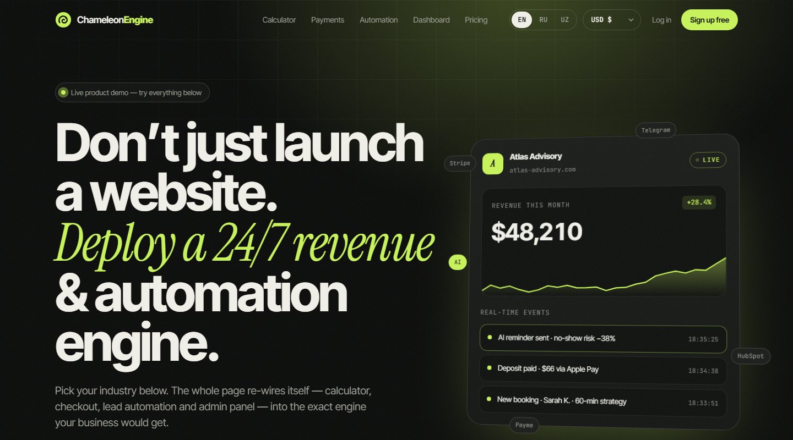
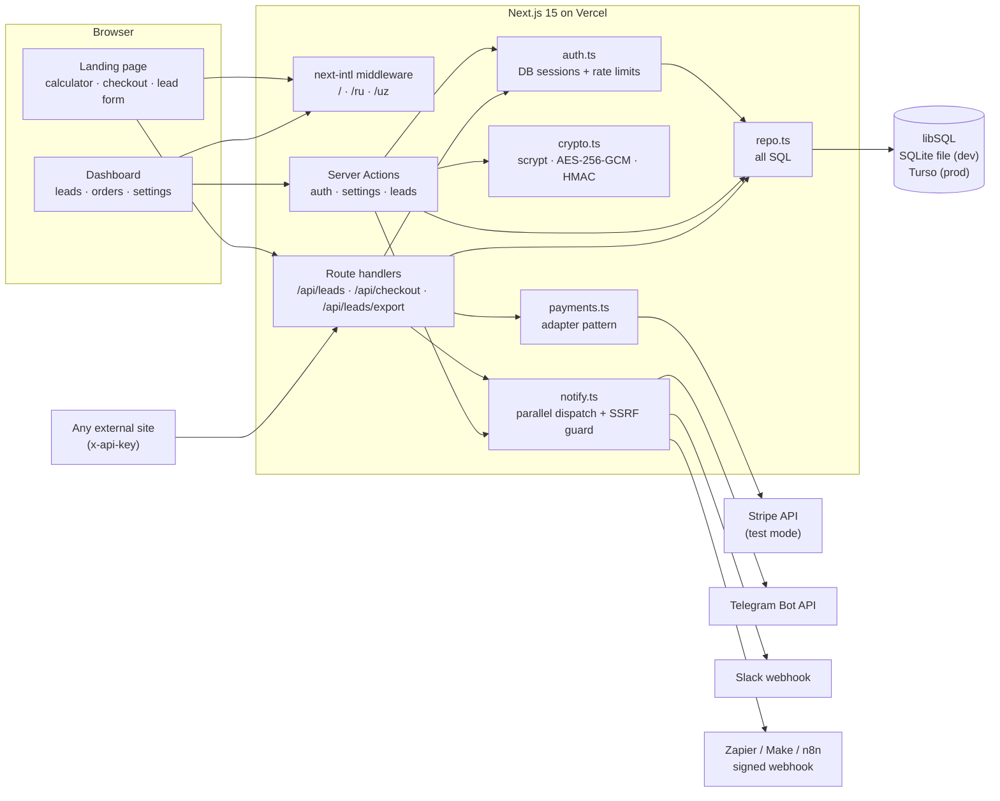

<div align="center">

# Chameleon Engine

**One landing page that rewires itself for any industry, plus the real product behind it:**
accounts, a database, a dashboard, signed webhooks and a public lead-capture API.

[**Live demo →**](https://chameleonengine.vercel.app)


[](https://chameleonengine.vercel.app)

</div>

## Why it exists

Most small-business sites are brochures. Chameleon Engine shows what a site looks like when it is
built to **capture, qualify and act on revenue**. Pick an industry (service, production, logistics, SaaS)
and the whole page re-wires itself: price calculator, checkout, lead automation and admin preview.
Sign up and the same flows run against **your own account**, so leads land in a real database
and real alerts fire in Telegram, Slack or any webhook.

It has no UI component library, a single database layer, and every external call has a
timeout, a rate limit and an input check.

**Lighthouse 12 on the live site:** desktop **95 / 100 / 100 / 100**, mobile (throttled 4G) **85 / 100 / 100 / 100**
(performance / accessibility / best practices / SEO).

## Features

| Area | What the code actually does |
| --- | --- |
| **Industry modes** | 4 presets (`src/lib/industries.ts`) drive the calculator fields, pricing formula, demo events and brand colour. All copy lives in `messages/*.json` |
| **Quote calculator** | Chips, ranges and add-ons per industry; live total, deposit and summary in the selected currency |
| **Checkout** | `POST /api/checkout` uses an adapter pattern (`src/server/payments.ts`). **Stripe** makes a real *test-mode* PaymentIntent when `STRIPE_SECRET_KEY=sk_test_…` is set. Every other gateway (PayPal, Payme, Click, YooKassa…) goes through a sandbox adapter. Region-aware gateway lists for Global / CIS / Uzbekistan |
| **PDF invoice** | Dependency-free, hand-written single-page PDF generator (`src/lib/pdf.ts`) |
| **Lead capture API** | `POST /api/leads`, CORS-enabled, authenticated by a rotatable per-account `x-api-key` or the session cookie; validated, scored, stored, dispatched |
| **Lead scoring** | Rule-based: budget bracket plus urgency / purchase / price-intent keywords in EN, RU and UZ (`src/lib/qualify.ts`). The same code runs on the server and in the UI preview |
| **Alerts** | One `dispatch()` fans out in parallel, each with a 5 s timeout, to a **Telegram bot**, a **Slack incoming webhook** and a **signed generic webhook** (Zapier / Make / n8n) |
| **Accounts** | Sign up, log in, log out, profile, language, password change (signs out other sessions), delete account (cascades all data) |
| **Dashboard** | KPIs, 30-day revenue, onboarding checklist; leads (search, status, delete, **CSV export**); orders; settings |
| **i18n** | English, Russian, Uzbek via `next-intl`; `/` is English, `/ru` and `/uz` are explicit; localized privacy and terms pages |
| **SEO** | Per-locale metadata with canonical + `hreflang` alternates and a generated Open Graph image (`opengraph-image.tsx`) |

## Security

| Concern | Implementation |
| --- | --- |
| Passwords | `scrypt` (N=16384, r=8, p=1), per-user 16-byte salt, NFKC normalisation, `timingSafeEqual`; a dummy hash keeps login timing identical for unknown emails |
| Sessions | 256-bit random token in an `httpOnly`, `SameSite=Lax`, `Secure` (prod) cookie. The DB stores only its SHA-256, so a leaked database cannot be replayed. 30-day TTL |
| Brute force | Sliding-window limits stored in the DB: login 30 / 15 min per IP **and** 8 / 15 min per email; sign-up 10 / h per IP; lead API 30 / min and checkout 20 / min per IP |
| Secrets at rest | User Telegram tokens, Slack and webhook URLs encrypted with **AES-256-GCM** (key derived from `AUTH_SECRET`) |
| Outgoing webhooks | `HMAC-SHA256` signature over `timestamp.body`, per-account signing secret, redirects disabled |
| SSRF | In production, user webhook URLs must be `https`, contain no credentials and resolve only to public IPs (private, loopback, link-local and CGNAT ranges blocked). Slack URLs must match the official incoming-webhook pattern |
| Input | Size-capped JSON bodies (16 KB), length-clamped fields, strict email / Slack URL patterns, integer and range checks on amounts |
| CSV export | Every cell quoted; leading `= + - @` neutralised against spreadsheet formula injection |
| Headers | `X-Content-Type-Options`, `X-Frame-Options: DENY`, `Referrer-Policy`, `Permissions-Policy`; `X-Powered-By` removed |
| Production guard | The app refuses to start in production without a 32+ character `AUTH_SECRET`, and refuses a local SQLite file on Vercel |

## Architecture



- **Only `src/server/db.ts` and `src/server/repo.ts` touch SQL.** Versioned migrations in a `_migrations`
  table are applied atomically and are safe under concurrent serverless cold starts.
- **Swapping the database** (e.g. to PostgreSQL) means re-implementing `repo.ts` with the same async
  signatures. Nothing else changes.
- **Adding a payment gateway** means one class implementing `PaymentService`, picked in `pickAdapter()`.

```
src/
├─ app/[locale]/         pages: landing, login, signup, dashboard/*, privacy, terms, OG image
├─ app/api/              leads, leads/export (CSV), checkout
├─ components/           landing sections, dashboard chrome, auth forms (no UI library)
├─ i18n/                 next-intl routing + request config
├─ lib/                  industries, pricing, scoring, gateways, PDF, client store
└─ server/               db, repo, auth, crypto, notify, payments, telegram, validation, actions/
messages/                en.json · ru.json · uz.json
```

## Run locally

Requires Node.js 20+.

```bash
git clone https://github.com/xoliddev/chameleon-engine.git
cd chameleon-engine
npm install
npm run dev            # http://localhost:3010
```

No setup is needed for development. The SQLite database is created on first request at `data/chameleon.db`,
and a dev-only secret is generated into `data/.auth-secret` (both gitignored).

| Script | Purpose |
| --- | --- |
| `npm run dev` | Dev server on port 3010 |
| `npm run build` | Production build (includes type checking) |
| `npm start` | Serve the production build on port 3010 (needs `AUTH_SECRET`) |
| `npm run typecheck` | `tsc --noEmit` |

## Environment variables

Copy `.env.example` to `.env.local`. Everything is optional in development.

| Variable | Required | Description |
| --- | --- | --- |
| `AUTH_SECRET` | **Production** | 32+ random characters. Encrypts stored bot tokens and webhook URLs and derives webhook signing secrets. Generate: `node -e "console.log(require('crypto').randomBytes(48).toString('base64url'))"` |
| `DATABASE_URL` | **Production** | `libsql://<db>.turso.io`. Empty locally (uses `file:data/chameleon.db`). `TURSO_DATABASE_URL` from the Vercel–Turso integration also works |
| `DATABASE_AUTH_TOKEN` | **Production** | Turso database token (`TURSO_AUTH_TOKEN` also accepted) |
| `NEXT_PUBLIC_FIVERR_URL` | No | Target of every "Order on Fiverr" button. Baked in at build time |
| `NEXT_PUBLIC_SITE_URL` | No | Public base URL. On Vercel it falls back to the production `*.vercel.app` domain |
| `STRIPE_SECRET_KEY` | No | Enables real Stripe charges in **test mode only**. Must start with `sk_test_` |
| `DEMO_TELEGRAM_BOT_TOKEN` | No | Telegram alerts for leads from anonymous visitors on the public demo |
| `DEMO_TELEGRAM_CHAT_ID` | No | Chat for the demo Telegram alerts |
| `DEMO_SLACK_WEBHOOK_URL` | No | Slack alerts for anonymous demo leads |

Signed-in users connect their own Telegram, Slack and webhook in **Dashboard → Settings**. Those are stored encrypted per account, not in env vars.

## Public API

### Capture a lead from any site

```bash
curl -X POST https://chameleonengine.vercel.app/api/leads \
  -H "content-type: application/json" \
  -H "x-api-key: pk_…" \
  -d '{"name":"Jane Doe","email":"jane@acme.com","budget":2,"message":"Ready to order this week"}'
```

`budget` is an index: `0` = under $500, `1` = $500–2k, `2` = $2k–10k, `3` = $10k+.
The response includes the lead id, score, intent, DB latency and per-channel delivery status.
Your key is in **Dashboard → Settings** and can be rotated at any time.
Without a key or session, the lead goes to a public demo workspace whose rows are pruned after 7 days.

### Outgoing webhook format

```http
POST <your URL>
x-chameleon-event: lead.created          (or payment.succeeded)
x-chameleon-timestamp: 1792776000
x-chameleon-signature: sha256=<hex HMAC-SHA256 of "timestamp.body" with your signing secret>

{"event":"lead.created","account":"Your Business","sentAt":"…","data":{"id":"ld_…","name":"…","email":"…","budgetUsd":5000,"score":92,"intent":"intent_buy","message":"…","source":"Website form"}}
```

The signing secret is shown in **Dashboard → Settings → Webhook**.

## Deployment

The app runs on the free tiers of **Vercel + Turso**:

1. Create a Turso database and a read/write token.
2. `npx vercel link`, then add `AUTH_SECRET`, `DATABASE_URL`, `DATABASE_AUTH_TOKEN` (and optionally `NEXT_PUBLIC_FIVERR_URL`) with `npx vercel env add <NAME> production`.
3. `npx vercel --prod`. Tables are created by migrations on the first request.

A step-by-step guide (in Uzbek) is in [DEPLOY.md](DEPLOY.md). `vercel.json` pins the functions to `fra1`.

## License

[MIT](LICENSE) © 2026 xoliddev
