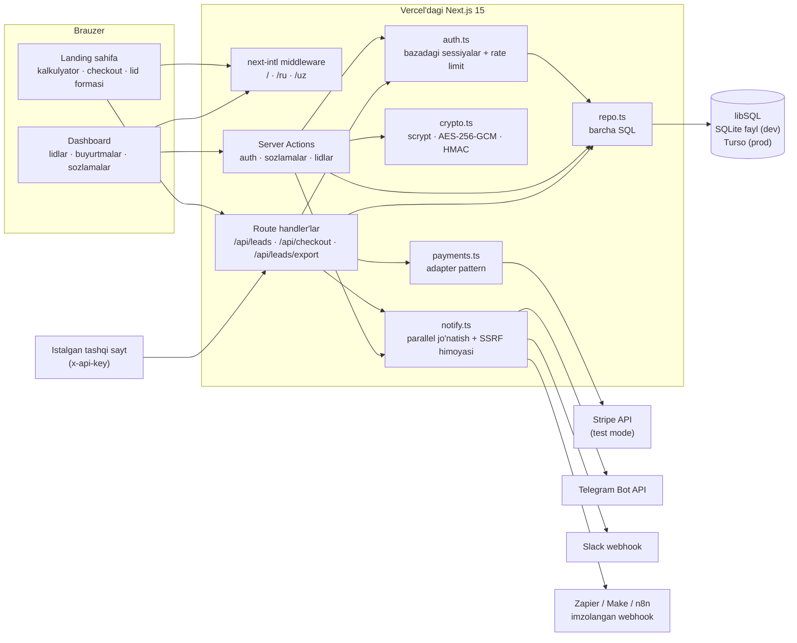

<div align="center">

# Chameleon Engine

[English](README.md) · **O'zbekcha**

[](https://chameleonengine.vercel.app)

**Istalgan sohaga moslashib, o'zini qayta quradigan bitta landing sahifa va uning ortidagi haqiqiy mahsulot:**
akkauntlar, ma'lumotlar bazasi, dashboard, imzolangan webhook'lar va lidlarni yig'ish uchun ochiq API.

[**Jonli demo →**](https://chameleonengine.vercel.app)


[](https://chameleonengine.vercel.app)

</div>

## Nega yaratilgan

Kichik bizneslarning ko'pchilik saytlari shunchaki buklet. Chameleon Engine sayt **daromadni ushlab qolish,
saralash va unga qarab harakat qilish** uchun qurilsa, qanday ko'rinishini ko'rsatadi. Sohani tanlang
(xizmat ko'rsatish, ishlab chiqarish, logistika, SaaS) — butun sahifa o'zini qayta quradi: narx kalkulyatori,
checkout, lidlar avtomatizatsiyasi va admin ko'rinishi. Ro'yxatdan o'tsangiz, xuddi shu jarayonlar
**o'zingizning akkauntingizda** ishlaydi: lidlar haqiqiy bazaga tushadi, Telegram, Slack yoki istalgan
webhook'ga haqiqiy bildirishnomalar boradi.

Unda UI komponentlar kutubxonasi yo'q, ma'lumotlar bazasi bilan ishlaydigan qatlam bitta, har bir tashqi
so'rovda esa timeout, rate limit va kiruvchi ma'lumotlar tekshiruvi bor.

**Jonli saytda Lighthouse 12 natijalari:** desktop **95 / 100 / 100 / 100**, mobil (sekinlashtirilgan 4G) **85 / 100 / 100 / 100**
(performance / accessibility / best practices / SEO).

## Imkoniyatlar

| Bo'lim | Kod aslida nima qiladi |
| --- | --- |
| **Soha rejimlari** | 4 ta preset (`src/lib/industries.ts`) kalkulyator maydonlari, narx formulasi, demo hodisalar va brend rangini boshqaradi. Barcha matnlar `messages/*.json` da |
| **Narx kalkulyatori** | Har bir soha uchun chip'lar, diapazonlar va qo'shimcha xizmatlar; tanlangan valyutada jami summa, oldindan to'lov va xulosa jonli hisoblanadi |
| **Checkout** | `POST /api/checkout` adapter pattern'dan foydalanadi (`src/server/payments.ts`). `STRIPE_SECRET_KEY=sk_test_…` qo'yilgan bo'lsa, **Stripe** haqiqiy *test-mode* PaymentIntent yaratadi. Qolgan barcha to'lov tizimlari (PayPal, Payme, Click, YooKassa…) sandbox adapter orqali ishlaydi. Global / MDH / O'zbekiston uchun mintaqaga qarab to'lov tizimlari ro'yxati |
| **PDF hisob-faktura** | Hech qanday kutubxonasiz, qo'lda yozilgan bir sahifali PDF generator (`src/lib/pdf.ts`) |
| **Lid yig'ish API** | `POST /api/leads`, CORS yoqilgan, har bir akkauntning almashtirsa bo'ladigan `x-api-key` kaliti yoki sessiya cookie'si bilan autentifikatsiya; tekshiriladi, baholanadi, saqlanadi va jo'natiladi |
| **Lidlarni baholash** | Qoidalarga asoslangan: byudjet oralig'i hamda EN, RU va UZ tillaridagi shoshilinchlik / xarid / narx niyatini bildiruvchi kalit so'zlar (`src/lib/qualify.ts`). Bitta kod serverda ham, UI'dagi ko'rinishda ham ishlaydi |
| **Bildirishnomalar** | Bitta `dispatch()` parallel ravishda, har biri 5 soniyalik timeout bilan, **Telegram bot**, **Slack incoming webhook** va **imzolangan umumiy webhook**'ga (Zapier / Make / n8n) yuboradi |
| **Akkauntlar** | Ro'yxatdan o'tish, kirish, chiqish, profil, til, parolni almashtirish (boshqa sessiyalardan chiqaradi), akkauntni o'chirish (barcha ma'lumotlar ham o'chadi) |
| **Dashboard** | KPI'lar, 30 kunlik tushum, onboarding ro'yxati; lidlar (qidiruv, status, o'chirish, **CSV eksport**); buyurtmalar; sozlamalar |
| **i18n** | `next-intl` orqali ingliz, rus, o'zbek tillari; `/` — inglizcha, `/ru` va `/uz` aniq ko'rsatiladi; maxfiylik siyosati va foydalanish shartlari sahifalari ham tarjima qilingan |
| **SEO** | Har bir til uchun metadata, canonical + `hreflang` alternativlari va avtomatik yaratiladigan Open Graph rasmi (`opengraph-image.tsx`) |

## Xavfsizlik

| Muammo | Yechim |
| --- | --- |
| Parollar | `scrypt` (N=16384, r=8, p=1), har bir foydalanuvchiga 16 baytlik salt, NFKC normalizatsiya, `timingSafeEqual`; noma'lum email'lar uchun ham login vaqti bir xil bo'lishi uchun soxta hash ishlatiladi |
| Sessiyalar | `httpOnly`, `SameSite=Lax`, `Secure` (prod) cookie'dagi 256 bitlik tasodifiy token. Bazada faqat uning SHA-256 hash'i saqlanadi, shuning uchun baza tashqariga chiqib ketsa ham undan qayta foydalanib bo'lmaydi. Amal qilish muddati 30 kun |
| Brute force | Bazada saqlanadigan sliding-window limitlar: login har bir IP uchun 15 daqiqada 30 ta **va** har bir email uchun 15 daqiqada 8 ta; ro'yxatdan o'tish har bir IP uchun soatiga 10 ta; lid API daqiqasiga 30 ta va checkout daqiqasiga 20 ta (IP bo'yicha) |
| Saqlangan maxfiy ma'lumotlar | Foydalanuvchilarning Telegram tokenlari, Slack va webhook URL'lari **AES-256-GCM** bilan shifrlanadi (kalit `AUTH_SECRET` dan olinadi) |
| Chiquvchi webhook'lar | `timestamp.body` ustidan `HMAC-SHA256` imzo, har bir akkauntning o'z imzo kaliti, redirect'lar o'chirilgan |
| SSRF | Production'da foydalanuvchi webhook URL'lari `https` bo'lishi, ichida login-parol bo'lmasligi va faqat ochiq IP'larga resolve bo'lishi shart (private, loopback, link-local va CGNAT diapazonlari bloklanadi). Slack URL'lari rasmiy incoming-webhook shabloniga mos kelishi kerak |
| Kiruvchi ma'lumotlar | Hajmi cheklangan JSON (16 KB), uzunligi cheklangan maydonlar, qat'iy email / Slack URL shablonlari, summalar uchun butun son va diapazon tekshiruvlari |
| CSV eksport | Har bir katak qo'shtirnoqqa olinadi; jadvalga formula kiritish hujumlariga qarshi boshidagi `= + - @` belgilari zararsizlantiriladi |
| Header'lar | `X-Content-Type-Options`, `X-Frame-Options: DENY`, `Referrer-Policy`, `Permissions-Policy`; `X-Powered-By` olib tashlangan |
| Production himoyasi | Ilova production'da 32+ belgili `AUTH_SECRET` bo'lmasa ishga tushmaydi, Vercel'da esa lokal SQLite faylini qabul qilmaydi |

## Arxitektura



- **SQL bilan faqat `src/server/db.ts` va `src/server/repo.ts` ishlaydi.** `_migrations` jadvalidagi
  versiyalangan migratsiyalar atomar qo'llanadi va bir vaqtda bo'ladigan serverless cold start'larda ham xavfsiz.
- **Ma'lumotlar bazasini almashtirish** (masalan, PostgreSQL'ga) uchun `repo.ts` ni xuddi shu async
  signaturalar bilan qayta yozish kifoya. Boshqa hech narsa o'zgarmaydi.
- **Yangi to'lov tizimi qo'shish** — `PaymentService` ni implement qiladigan bitta klass yozib, uni `pickAdapter()` da tanlash demak.

```
src/
├─ app/[locale]/         sahifalar: landing, login, signup, dashboard/*, privacy, terms, OG rasm
├─ app/api/              leads, leads/export (CSV), checkout
├─ components/           landing bo'limlari, dashboard qobig'i, auth formalari (UI kutubxonasiz)
├─ i18n/                 next-intl routing + request konfiguratsiyasi
├─ lib/                  sohalar, narxlash, baholash, to'lov tizimlari, PDF, klient store
└─ server/               db, repo, auth, crypto, notify, payments, telegram, validation, actions/
messages/                en.json · ru.json · uz.json
```

## Lokal ishga tushirish

Node.js 20+ kerak.

```bash
git clone https://github.com/xoliddev/chameleon-engine.git
cd chameleon-engine
npm install
npm run dev            # http://localhost:3010
```

Development uchun hech narsa sozlash shart emas. SQLite bazasi birinchi so'rovda `data/chameleon.db` da
yaratiladi, faqat dev uchun mo'ljallangan maxfiy kalit esa `data/.auth-secret` ga yoziladi (ikkalasi ham gitignore'da).

| Skript | Vazifasi |
| --- | --- |
| `npm run dev` | 3010-portda dev server |
| `npm run build` | Production build (tiplarni tekshirish bilan birga) |
| `npm start` | Production build'ni 3010-portda ishga tushiradi (`AUTH_SECRET` kerak) |
| `npm run typecheck` | `tsc --noEmit` |

## Muhit o'zgaruvchilari

`.env.example` ni `.env.local` ga nusxalang. Development'da hammasi ixtiyoriy.

| O'zgaruvchi | Majburiy | Tavsif |
| --- | --- | --- |
| `AUTH_SECRET` | **Production** | 32+ tasodifiy belgi. Saqlangan bot tokenlari va webhook URL'larini shifrlaydi, webhook imzo kalitlari ham undan olinadi. Yaratish: `node -e "console.log(require('crypto').randomBytes(48).toString('base64url'))"` |
| `DATABASE_URL` | **Production** | `libsql://<db>.turso.io`. Lokal muhitda bo'sh qoldiriladi (`file:data/chameleon.db` ishlatiladi). Vercel–Turso integratsiyasidan keladigan `TURSO_DATABASE_URL` ham ishlaydi |
| `DATABASE_AUTH_TOKEN` | **Production** | Turso baza tokeni (`TURSO_AUTH_TOKEN` ham qabul qilinadi) |
| `NEXT_PUBLIC_FIVERR_URL` | Yo'q | Barcha "Order on Fiverr" tugmalari olib boradigan manzil. Build vaqtida kodga yoziladi |
| `NEXT_PUBLIC_SITE_URL` | Yo'q | Ochiq asosiy URL. Vercel'da bo'sh bo'lsa, production'dagi `*.vercel.app` domeni olinadi |
| `STRIPE_SECRET_KEY` | Yo'q | Stripe orqali haqiqiy to'lovlarni yoqadi, **faqat test mode'da**. `sk_test_` bilan boshlanishi shart |
| `DEMO_TELEGRAM_BOT_TOKEN` | Yo'q | Ochiq demodagi anonim tashrif buyuruvchilar lidlari uchun Telegram bildirishnomalari |
| `DEMO_TELEGRAM_CHAT_ID` | Yo'q | Demo Telegram bildirishnomalari boradigan chat |
| `DEMO_SLACK_WEBHOOK_URL` | Yo'q | Anonim demo lidlari uchun Slack bildirishnomalari |

Tizimga kirgan foydalanuvchilar o'z Telegram, Slack va webhook'ini **Dashboard → Settings** bo'limida ulaydi. Ular env o'zgaruvchilarda emas, har bir akkaunt uchun shifrlangan holda saqlanadi.

## Ochiq API

### Istalgan saytdan lid qabul qilish

```bash
curl -X POST https://chameleonengine.vercel.app/api/leads \
  -H "content-type: application/json" \
  -H "x-api-key: pk_…" \
  -d '{"name":"Jane Doe","email":"jane@acme.com","budget":2,"message":"Ready to order this week"}'
```

`budget` — indeks: `0` = $500 dan kam, `1` = $500–2k, `2` = $2k–10k, `3` = $10k+.
Javobda lid id'si, bahosi, niyati, bazaning javob vaqti va har bir kanal bo'yicha yetkazilish holati bo'ladi.
Kalitingiz **Dashboard → Settings** bo'limida turadi va uni istalgan payt almashtirish mumkin.
Kalit yoki sessiya bo'lmasa, lid ochiq demo workspace'ga tushadi, u yerdagi yozuvlar 7 kundan keyin o'chiriladi.

### Chiquvchi webhook formati

```http
POST <sizning URL>
x-chameleon-event: lead.created          (yoki payment.succeeded)
x-chameleon-timestamp: 1792776000
x-chameleon-signature: sha256=<imzo kalitingiz bilan "timestamp.body" ning HMAC-SHA256 hex qiymati>

{"event":"lead.created","account":"Your Business","sentAt":"…","data":{"id":"ld_…","name":"…","email":"…","budgetUsd":5000,"score":92,"intent":"intent_buy","message":"…","source":"Website form"}}
```

Imzo kaliti **Dashboard → Settings → Webhook** bo'limida ko'rsatilgan.

## Deploy

Ilova **Vercel + Turso** ning bepul tariflarida ishlaydi:

1. Turso'da baza va o'qish/yozish huquqli token yarating.
2. `npx vercel link`, keyin `npx vercel env add <NAME> production` bilan `AUTH_SECRET`, `DATABASE_URL`, `DATABASE_AUTH_TOKEN` (va xohlasangiz `NEXT_PUBLIC_FIVERR_URL`) ni qo'shing.
3. `npx vercel --prod`. Jadvallar birinchi so'rovda migratsiyalar orqali yaratiladi.

Qadamma-qadam qo'llanma (o'zbek tilida) [DEPLOY.md](DEPLOY.md) faylida. `vercel.json` funksiyalarni `fra1` mintaqasiga bog'laydi.

## Litsenziya

[MIT](LICENSE) © 2026 xoliddev
